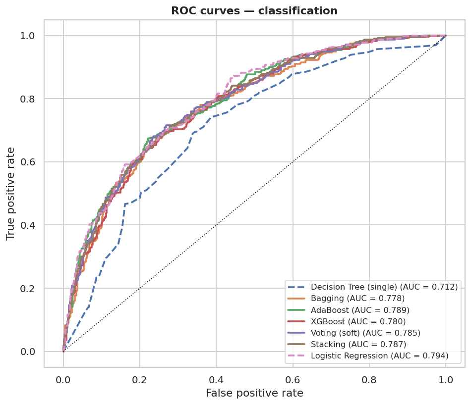
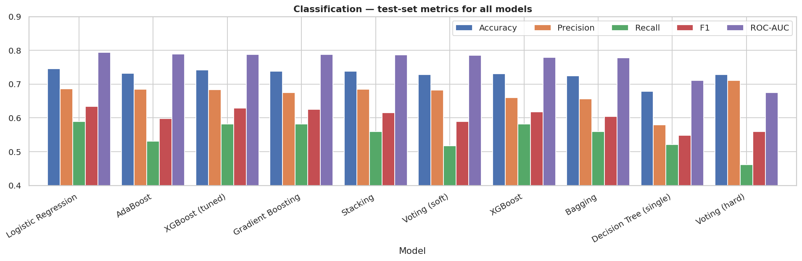
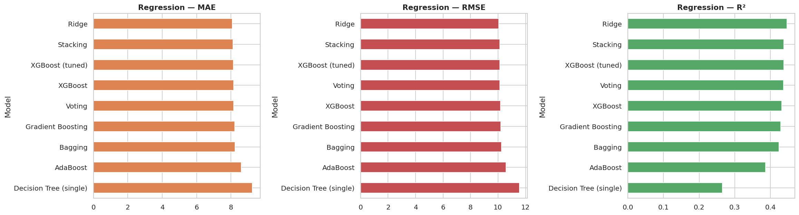
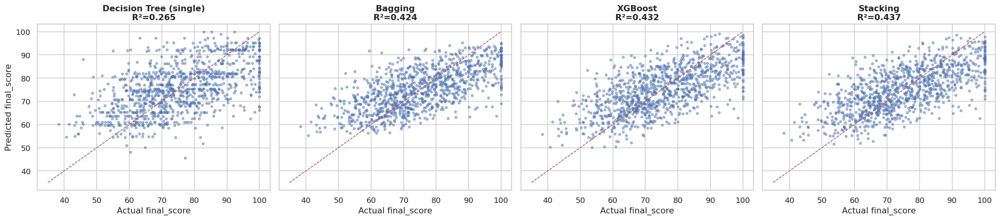
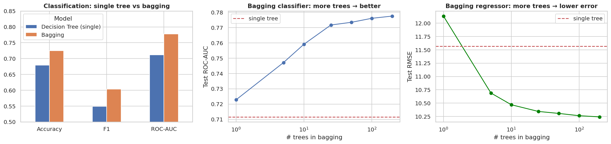
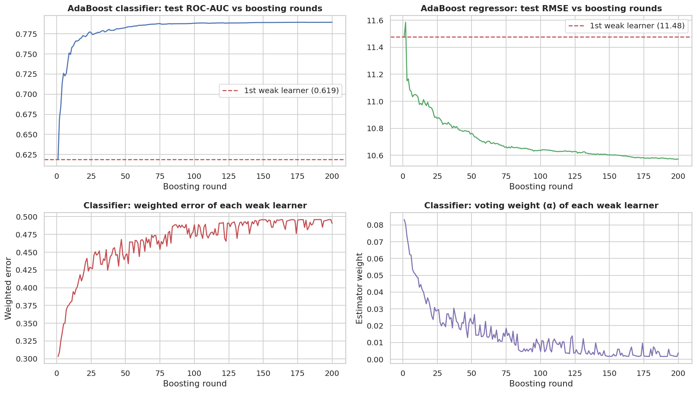
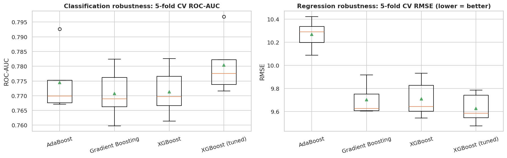
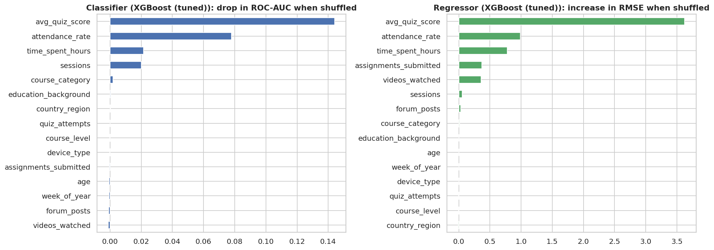

# 🎓 Smart Outcome Predictor — Ensemble Learning Project

> **Red & White Skill Education · Supervised Learning · 6-hour project**
> An ensemble-based machine-learning system that predicts **(1)** whether a student will **complete an online course** (classification) and **(2)** the student's **final performance score** (regression), using Bagging, Boosting (AdaBoost, Gradient Boosting, XGBoost), Voting and Stacking — with a **Streamlit web app** for live predictions.

| | |
|---|---|
| **Notebook** | [`Smart_Outcome_Predictor.ipynb`](Smart_Outcome_Predictor.ipynb) (all 32 tasks, executed top-to-bottom, zero errors) |
| **Streamlit app** | [`app.py`](app.py) — live URL: **`<PASTE YOUR STREAMLIT URL HERE>`** |
| **Video explanation** | **`<PASTE YOUR GOOGLE-DRIVE / YOUTUBE-UNLISTED LINK HERE>`** |
| **Theory document (PDF)** | [`docs/Theory_Concepts.pdf`](docs/Theory_Concepts.pdf) |
| **Final report (PDF)** | [`docs/Final_Report.pdf`](docs/Final_Report.pdf) |

---

## 📑 Table of contents
1. [Problem statement & objective](#1-problem-statement--objective)
2. [Headline results](#2-headline-results)
3. [Repository structure](#3-repository-structure)
4. [Dataset & data dictionary](#4-dataset--data-dictionary)
5. [Methodology](#5-methodology)
6. [Task coverage (Parts A–G)](#6-task-coverage-parts-ag)
7. [Detailed results](#7-detailed-results)
8. [Streamlit app](#8-streamlit-app)
9. [Installation & how to reproduce](#9-installation--how-to-reproduce)
10. [Deploying to GitHub & Streamlit Community Cloud](#10-deploying-to-github--streamlit-community-cloud)
11. [Assumptions, limitations & future work](#11-assumptions-limitations--future-work)
12. [Submission checklist (marking criteria)](#12-submission-checklist-marking-criteria)
13. [Troubleshooting](#13-troubleshooting)

---

## 1. Problem statement & objective
You are a Machine Learning Engineer at an EdTech analytics company. Single models give unstable predictions, so the platform wants a **Smart Outcome Predictor** built from **ensembles** that improve accuracy, generalisation and robustness:

| Task | Target | Type |
|---|---|---|
| Course completion | `completion_status` (0 = not completed, 1 = completed) | **Classification** |
| Final performance | `final_score` (0–100) | **Regression** |

**Objective:** explore bagging, boosting, voting and stacking, understand how each improves generalisation / stability / performance for both task types, identify the best model per task, and deploy it in a web app.

---

## 2. Headline results

| | Classification (`completion_status`) | Regression (`final_score`) |
|---|---|---|
| **Best ensemble (selected by 5-fold CV)** | **XGBoost (tuned)** | **XGBoost (tuned)** |
| Test metrics | Accuracy **0.742** · Precision 0.684 · Recall 0.582 · F1 **0.629** · ROC-AUC **0.788** | MAE **8.13** · RMSE **10.12** · R² **0.437** |
| Single decision tree (baseline) | ROC-AUC 0.712 · F1 0.549 | RMSE 11.57 · R² 0.265 |
| Linear benchmark (LogReg / Ridge) | ROC-AUC 0.794 · F1 0.634 | RMSE 10.04 · R² 0.446 |

**Key takeaways**
* ✅ **Ensembles clearly beat a single decision tree** on both tasks (ROC-AUC 0.71 → 0.79; RMSE 11.6 → 10.1) and boosting in particular over-fits far less (bagging only modestly).
* ⚖️ **The top ensembles are practically tied** (differences ≈ 1 CV standard deviation). Boosting gives the smallest train–test gap; bagging mostly reduces variance; stacking matches the best boosters; soft voting beats hard voting.
* 🔎 **Honest finding:** a plain Logistic Regression / Ridge benchmark is statistically tied (marginally better) with the best ensemble on this dataset, because the signal is mostly linear and the data are noisy. The ensemble is deployed because the project objective is an ensemble solution and it is robust to non-linear patterns — see [§7.5](#75-honest-note-about-the-linear-benchmark).
* 🎯 **Drivers:** assessment & engagement (`avg_quiz_score`, `attendance_rate`, `time_spent_hours`) matter most — demographics add very little.

---

## 3. Repository structure
```
Smart_Outcome_Predictor/
├── README.md                        ← this file
├── Smart_Outcome_Predictor.ipynb    ← full solution (Parts A–G), executed, Restart-&-Run-All clean
├── app.py                           ← Streamlit web app
├── requirements.txt                 ← runtime dependencies (pinned for model compatibility)
├── requirements-dev.txt             ← + Jupyter & PDF tooling (optional)
├── VIDEO_SCRIPT.md                  ← script/checklist for the 5–10 min recorded explanation
├── .gitignore
├── data/
│   └── Smart_Outcome_Predictor_Dataset_5200.xlsx
├── models/                          ← written by the notebook, read by the app
│   ├── best_classifier.joblib       ← full pipeline (preprocessing + XGBoost (tuned))
│   ├── best_regressor.joblib        ← full pipeline (preprocessing + XGBoost (tuned))
│   └── metadata.json                ← feature lists, category options, ranges, metrics
├── outputs/                         ← evaluation tables (CSV)
│   ├── classification_results.csv
│   ├── regression_results.csv
│   ├── best_models_summary.csv
│   ├── bagging_vs_boosting_classification.csv / _regression.csv
│   └── feature_importance_classification.csv / _regression.csv
├── screenshots/                     ← 17 labelled plots exported by the notebook (01 … 17)
├── docs/
│   ├── Theory_Concepts.pdf          ← definitions for Part A (3 pages)
│   └── Final_Report.pdf             ← Part G report (5 pages)
└── scripts/
    └── make_pdfs.py                 ← regenerates the two PDFs from the notebook outputs
```

---

## 4. Dataset & data dictionary
`data/Smart_Outcome_Predictor_Dataset_5200.xlsx` — **5,200 students × 19 columns**, no duplicate students. (Column descriptions are inferred from the column names.)

| Column | Type | Description | Range / values | Used as |
|---|---|---|---|---|
| `student_id` | int | Unique identifier | 700001–705200 | ❌ dropped (no signal) |
| `age` | int | Student age | 16–45 | feature |
| `country_region` | cat | Region of the student | Asia, Americas, Europe, Africa, Oceania | feature |
| `device_type` | cat | Main learning device | Mobile, Laptop, Tablet | feature |
| `education_background` | cat | Education level | Undergrad, Graduate, WorkingPro, HighSchool | feature |
| `course_level` | cat | Difficulty of the course | Beginner, Intermediate, Advanced | feature |
| `course_category` | cat | Subject area | Data, Programming, Business, Design, Marketing | feature |
| `course_start_date` | date | Course start | 2024-01-01 … 2024-12-30 | ❌ dropped (seasonality already in `week_of_year`) |
| `week_of_year` | int | Week of year the course started | 1–52 | feature |
| `sessions` | int | Number of learning sessions | 1–94 | feature |
| `time_spent_hours` | float | Total time spent | 0.6–76.8 (**112 missing**) | feature |
| `videos_watched` | int | Videos watched | 0–158 | feature |
| `quiz_attempts` | int | Quiz attempts | 0–20 | feature |
| `assignments_submitted` | int | Assignments submitted | 0–12 | feature |
| `forum_posts` | int | Forum posts | 0–8 | feature |
| `avg_quiz_score` | float | Average quiz score | 0–100 (**81 missing**) | feature |
| `attendance_rate` | float | Share of sessions attended | 0.31–1.00 (**80 missing**) | feature |
| `completion_status` | int | **Target (classification)** | 0 / 1 — 37.5 % completed | target |
| `final_score` | float | **Target (regression)** | 35.2–100 (mean 74.8) | target |

---

## 5. Methodology

### 5.1 Preprocessing & leakage control
* **Features (15):** 10 numeric + 5 categorical (table above). `student_id` and `course_start_date` are dropped.
* **No target leakage:** `completion_status` and `final_score` correlate at **r ≈ 0.69**. Neither is ever used as a feature for the other task, because at prediction time both are unknown. (Documented assumption.)
* **Split:** one **80 / 20 stratified** train–test split (`random_state=42`), shared by both tasks, so every model is judged on the *same* held-out students (4,160 train / 1,040 test).
* **Preprocessing** (inside every model's `Pipeline`, so it is fitted on training folds only): numeric → median imputation → `StandardScaler`; categorical → `OneHotEncoder(handle_unknown="ignore")`.
* **Imbalance:** 37.5 % positives → F1, Recall and ROC-AUC are reported in addition to accuracy.

### 5.2 Models and hyper-parameters
| Family | Classifier | Regressor |
|---|---|---|
| **Single baseline** | `DecisionTreeClassifier(max_depth=8)` | `DecisionTreeRegressor(max_depth=8)` |
| **Bagging** | `BaggingClassifier` — 200 × depth-8 trees, bootstrap, OOB score | `BaggingRegressor` — 200 × depth-8 trees, OOB score |
| **AdaBoost** | 200 × depth-2 trees, learning rate 0.1 | 200 × depth-3 trees, learning rate 0.1 |
| **Gradient Boosting** | scikit-learn defaults | scikit-learn defaults |
| **XGBoost** | 300 trees, depth 3, lr 0.05, subsample 0.8, colsample 0.8 | same |
| **XGBoost (tuned)** | `RandomizedSearchCV` (20 iterations, 3-fold, on training data only) over trees / depth / lr / subsample / colsample / min_child_weight / λ | same |
| **Voting** | LogReg + KNN(25) + DecisionTree(5) + SVC(rbf); **hard** vs **soft** | Ridge + KNN + DecisionTree + SVR (average) |
| **Stacking** | RandomForest + XGBoost + AdaBoost + KNN → **LogisticRegression** meta-learner, 5-fold out-of-fold | RandomForest + XGBoost + AdaBoost + KNN → **Ridge** meta-learner |
| **Benchmarks** | Logistic Regression, KNN, SVC | Ridge, KNN, SVR |

### 5.3 Evaluation protocol
* **Classification:** Accuracy, Precision, Recall, F1, ROC-AUC (+ confusion matrices, ROC curves).
* **Regression:** MAE, RMSE, R² (+ actual-vs-predicted, residual plots).
* **Robustness:** 5-fold cross-validation on the training set for every model (mean ± std); train-vs-test gaps to quantify over-fitting.
* **Model selection (Task 30):** among the *ensemble* techniques, the **best 5-fold CV score** (ROC-AUC / RMSE) — *not* the test score — picks the deployed model; the test set is only used as the final unbiased check. The selected pipelines are then refit on all 5,200 rows and saved.
* **Explainability:** model-agnostic permutation importance on the test set.

---

## 6. Task coverage (Parts A–G)
| Part | Tasks | Where | Status |
|---|---|---|---|
| **A** Conceptual foundation | 1–5 | Notebook *Part A* + [`docs/Theory_Concepts.pdf`](docs/Theory_Concepts.pdf) | ✅ |
| **B** Dataset understanding & preparation | 6 features/targets · 7 train–test split · 8 preprocessing | Notebook *Part B* (EDA plots `01`–`04`) | ✅ |
| **C** Bagging | 9 classifier · 10 regressor · 11 vs single model | Notebook *Part C* (plot `05`) | ✅ |
| **D** Boosting | 12–14 AdaBoost (+ sequential analysis) · 15–17 XGBoost (+ comparison & robustness) | Notebook *Part D* (plots `06`, `07`) | ✅ |
| **E** Voting & Stacking | 18 voting · 19 hard vs soft · 20 stacking classifier · 21 stacking regressor | Notebook *Part E* (plots `08`, `09`) | ✅ |
| **F** Evaluation & comparison | classification metrics · regression metrics · best model | Notebook *Part F* (plots `10`–`17`) | ✅ |
| **G** Final analysis & reporting | 31 report · 32 deliverables | Notebook *Part G* + [`docs/Final_Report.pdf`](docs/Final_Report.pdf) + app + this README | ✅ |

---

## 7. Detailed results

### 7.1 Classification — `completion_status` (test set, sorted by ROC-AUC)
| Model | Family | Accuracy | Precision | Recall | F1 | ROC-AUC | CV ROC-AUC (mean ± std) |
|---|---|---|---|---|---|---|---|
| Logistic Regression | Base learner | 0.745 | 0.687 | 0.590 | 0.634 | 0.794 | 0.785 ± 0.009 |
| AdaBoost | Boosting | 0.733 | 0.685 | 0.531 | 0.598 | 0.789 | 0.774 ± 0.009 |
| **XGBoost (tuned)** | Boosting | 0.742 | 0.684 | 0.582 | 0.629 | 0.788 | 0.780 ± 0.009 |
| Gradient Boosting | Boosting | 0.739 | 0.676 | 0.582 | 0.625 | 0.788 | 0.771 ± 0.008 |
| Stacking | Stacking | 0.739 | 0.685 | 0.559 | 0.616 | 0.787 | 0.779 ± 0.011 |
| Voting (soft) | Voting | 0.729 | 0.682 | 0.518 | 0.589 | 0.785 | 0.776 ± 0.010 |
| XGBoost | Boosting | 0.731 | 0.660 | 0.582 | 0.619 | 0.780 | 0.771 ± 0.007 |
| Bagging | Bagging | 0.725 | 0.657 | 0.559 | 0.604 | 0.777 | 0.770 ± 0.012 |
| Decision Tree (single) | Single | 0.679 | 0.580 | 0.520 | 0.549 | 0.712 | 0.696 ± 0.015 |
| Voting (hard) | Voting | 0.728 | 0.712 | 0.462 | 0.560 | 0.675 | – |

*Hard voting has no probabilities; its ROC-AUC is computed from class labels and is not comparable. Models marked "Base learner" are the ingredients of voting.*




### 7.2 Regression — `final_score` (test set, sorted by RMSE)
| Model | Family | MAE | RMSE | R² | CV RMSE (mean ± std) |
|---|---|---|---|---|---|
| Ridge | Base learner | 8.084 | 10.045 | 0.446 | 9.536 ± 0.124 |
| Stacking | Stacking | 8.124 | 10.121 | 0.437 | 9.654 ± 0.119 |
| **XGBoost (tuned)** | Boosting | 8.131 | 10.123 | 0.437 | 9.626 ± 0.118 |
| Voting | Voting | 8.165 | 10.124 | 0.437 | 9.736 ± 0.132 |
| XGBoost | Boosting | 8.155 | 10.170 | 0.432 | 9.708 ± 0.146 |
| Gradient Boosting | Boosting | 8.207 | 10.200 | 0.428 | 9.701 ± 0.120 |
| Bagging | Bagging | 8.229 | 10.241 | 0.424 | 9.846 ± 0.082 |
| AdaBoost | Boosting | 8.606 | 10.572 | 0.386 | 10.268 ± 0.115 |
| Decision Tree (single) | Single | 9.239 | 11.566 | 0.265 | 11.469 ± 0.166 |




### 7.3 Bagging vs Boosting vs Voting vs Stacking — what we learned
| Question | Finding |
|---|---|
| **Does bagging help?** | Yes. Same depth-8 tree: ROC-AUC 0.712 → 0.777, RMSE 11.57 → 10.24. Error drops quickly over the first 25–50 trees and then plateaus. Deep trees still over-fit (train AUC ≈ 0.94). |
| **Does boosting help more?** | Boosting reaches equal/better test scores with a much smaller train–test gap (AdaBoost classification gap ≈ 0.01 vs bagging ≈ 0.16). XGBoost trains in ≈ 0.2 s vs ≈ 3 s for bagging. |
| **How do weak learners improve sequentially?** | A single AdaBoost weak learner reaches ROC-AUC ≈ 0.62; after 200 rounds ≈ 0.79. Each learner's weighted error rises from ≈ 0.30 towards 0.5 and its voting weight shrinks (plot `06`). |
| **XGBoost vs other boosting?** | Gradient Boosting, XGBoost and tuned XGBoost are close and stable across CV folds; AdaBoost is clearly weakest on regression (RMSE 10.57 vs ≈ 10.17). |
| **Hard vs soft voting?** | Soft voting wins (F1 0.589 vs 0.560) because it uses confidence. It does *not* beat its best member (Logistic Regression) since the members' errors are correlated. |
| **Is stacking worth it?** | Stacking matches the best boosters (AUC 0.787, RMSE 10.12) and *learns* trust weights (plot `09`), at the cost of longer training. |





### 7.4 Feature importance (what drives the predictions?)
Top drivers — classification: **avg_quiz_score, attendance_rate, time_spent_hours, sessions**; regression: **avg_quiz_score, attendance_rate, time_spent_hours, assignments_submitted**. Assessment performance and engagement dominate; demographic / categorical features contribute very little.



### 7.5 Honest note about the linear benchmark
On this dataset a **regularised linear model is statistically tied (marginally better) with the best ensemble** — Logistic Regression ROC-AUC 0.794 vs 0.788; Ridge RMSE 10.04 vs 10.12. The relationship between engagement and outcome is largely linear and the targets are noisy (many true scores are capped at exactly 100), so there is little non-linear structure for ensembles to exploit beyond what a single tree misses. The gain from ensembling is therefore **large versus a single tree** and **negligible versus a well-regularised linear model**. We deploy the ensemble because (i) the project asks for an ensemble solution, (ii) it is more robust to outliers / non-linearity if the data change, and (iii) accuracy is equal. If interpretability is the top priority, the linear model is a fully valid production alternative.

### 7.6 Business interpretation
* Rank students by **completion probability** and trigger early support (reminders, mentoring) for low quiz scores / low attendance in the first weeks.
* Use the **predicted score** to flag likely under-performers and offer targeted practice.
* Recall for completers at the default 0.5 threshold is moderate → choose the **decision threshold** from the cost of missing an at-risk student vs an unnecessary intervention (the app has a threshold slider).
* Expect **risk ranking, not certainty** (ROC-AUC ≈ 0.79, R² ≈ 0.44).

---

## 8. Streamlit app
`app.py` loads the saved pipelines from `models/` and offers five tabs:

| Tab | What it does |
|---|---|
| 🔮 **Predict** | Enter one student's profile → completion probability, predicted outcome (adjustable decision threshold), predicted final score with a grade band, and rule-based suggested actions |
| 📂 **Batch prediction** | Upload a CSV/Excel with the 15 feature columns → predictions for all students + download; input template provided |
| 📊 **Model comparison** | Test-set tables and plots of all ensemble models |
| 🔍 **Data explorer** | Dataset KPIs and completion / score by category |
| ℹ️ **About** | Methods, selected models and caveats |

Run locally: `streamlit run app.py` (opens http://localhost:8501).

---

## 9. Installation & how to reproduce
**Requirements:** Python **3.11+** (tested on 3.12). Exact library pins are in `requirements.txt`.

```bash
# 1. Clone and enter the project
git clone <YOUR-REPO-URL>.git
cd Smart_Outcome_Predictor

# 2. Create an environment and install dependencies
python -m venv .venv
source .venv/bin/activate            # Windows: .venv\Scripts\activate
pip install -r requirements-dev.txt  # (use requirements.txt if you only need the app)

# 3. Re-run the whole analysis (≈ 8–10 min on 1 CPU; regenerates plots, tables and models)
jupyter lab                          # open Smart_Outcome_Predictor.ipynb → Kernel ▸ Restart & Run All
#   or headless:
jupyter nbconvert --to notebook --execute Smart_Outcome_Predictor.ipynb --inplace

# 4. (optional) Regenerate the PDF documents
python scripts/make_pdfs.py

# 5. Launch the web app
streamlit run app.py
```
All randomness uses `random_state=42`, so results are reproducible. The notebook must be run **from the project root** (paths are relative).

---

## 10. Deploying to GitHub & Streamlit Community Cloud
1. **Create a GitHub repo** (public), e.g. `smart-outcome-predictor`.
2. Push the project (the `models/` folder is tiny and **must be committed** — the app loads it):
   ```bash
   git init && git add . && git commit -m "Smart Outcome Predictor: ensemble learning project"
   git branch -M main
   git remote add origin https://github.com/<your-username>/smart-outcome-predictor.git
   git push -u origin main
   ```
3. Go to **https://share.streamlit.io** → *New app* → select the repo, branch `main`, main file **`app.py`** → *Advanced settings* → Python **3.12** → *Deploy*.
4. Copy the app URL into the table at the top of this README (and the video link too), then commit & push again.
5. Add 1–2 **screenshots of the running app** to `screenshots/` (e.g. `app_predict.png`) and reference them here if you wish.

---

## 11. Assumptions, limitations & future work
* **Assumptions:** targets are mutually excluded as features; median imputation is adequate for ≈ 2 % missing values; a single 80/20 split plus 5-fold CV is sufficient for a 5,200-row dataset; column meanings were inferred from names.
* **Limitations:** moderate signal (ROC-AUC ≈ 0.79, R² ≈ 0.44); ceiling effect at `final_score = 100`; dataset appears synthetic; no fairness audit across regions/education levels; default 0.5 threshold gives moderate recall for completers.
* **Future work:** week-by-week activity features / early-warning models using only the first *k* weeks; probability calibration and threshold optimisation; quantile or censored regression for the score cap; SHAP explanations; fairness analysis; drift monitoring and scheduled retraining.

---

## 12. Submission checklist (marking criteria)
| Component | Marks | Deliverable | Status |
|---|---|---|---|
| **A. Technical completion** (Jupyter `.ipynb` + Streamlit app) | 5 | Completed notebook — all tasks, *Restart & Run All* clean · live working Streamlit URL | Notebook ✅ · **App URL: deploy & paste (§10)** |
| **B. Recorded video** (face + screen) | 3 | 5–10 min MP4/MOV, verbal explanations, shared via Google Drive link or YouTube unlisted | **Record with OBS using [`VIDEO_SCRIPT.md`](VIDEO_SCRIPT.md), paste link at top** |
| **C. GitHub repository + README** | 2 | Public repo with `.ipynb`, screenshots, README, video link, theory PDF | ✅ files ready · **push to GitHub (§10)** |

Before submitting: ☐ Streamlit URL works in an incognito window · ☐ video link is public/unlisted-viewable · ☐ links filled in at the top of this README · ☐ repo is public.

---

## 13. Troubleshooting
| Problem | Fix |
|---|---|
| `Trained models could not be loaded` in the app | Install the exact versions in `requirements.txt` (scikit-learn / xgboost pins matter for `.joblib` files) **or** re-run the notebook to regenerate `models/` with your installed versions |
| `FileNotFoundError: data/...xlsx` in the notebook | Start Jupyter **from the project root**; keep the dataset in `data/` |
| `ModuleNotFoundError: xgboost` / `openpyxl` | `pip install -r requirements.txt` |
| Notebook is slow | It fits ≈ 25 models with 5-fold CV (≈ 8–10 min on one CPU). Reduce `n_estimators` or CV folds for a quick run |
| Streamlit Cloud build fails | Choose Python 3.11 or 3.12 in *Advanced settings*; make sure `requirements.txt` is in the repo root |

---
*Built for the Red & White Skill Education "Smart Outcome Predictor" (Supervised Learning) project. Dataset provided by the course.*
